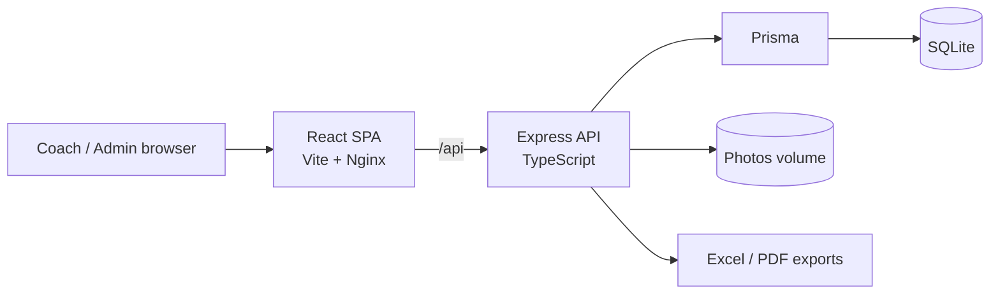
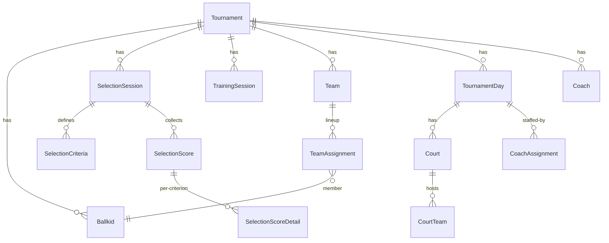

# Ballkids Manager

**Full-stack web app to manage the ball kids of an ATP tournament** (Rolex Monte-Carlo Masters): data collection, selection scoring, training sessions, team building, the 9-day tournament schedule, coach planning and exports.

In production, used by the tournament organisation and its coaches during the 2026 edition.

> ℹ️ This repository is a **project showcase**. The source code lives in a private repository because the production app handles personal data of minors and the deployment docs contain infrastructure details. **Read access to the code is available on request** (see [Access to the code](#access-to-the-code)).

## 🎥 Demo

<!-- VIDEO_EMBED: drag a .mp4 (< 10 MB) into this README on github.com, then paste the generated user-attachments link below -->
_Screen recording coming soon._

**Try it yourself**: a public demo instance runs with fictional data only. Every change you make is wiped and re-seeded automatically every 24 hours, so feel free to click everything.

| | |
|---|---|
| Demo URL | http://5.75.152.72:8080 |
| Admin account | `demo@demo.com` / `demo1234` |
| Coach account | `demo+coach1@example.com` / `demo1234` |

Suggested tour: validate the pending registrations, score a few kids in *Sélection*, check the ranking tab, then open *Tournoi* and hit *Générer* to build the day lineups.

---

## The problem

Every year the tournament recruits, tests, trains and schedules around a hundred teenage ball kids. Until now this ran on spreadsheets, paper score sheets and a lot of manual copy-pasting:

- coaches scored kids on paper during selection days, then someone re-typed everything;
- building balanced teams and the 9-day rotation (which team on which court, which day) was done by hand, and every absence meant redoing it;
- exports for the organisation (lists, outfit sizes, daily lineups) were rebuilt from scratch each time.

## The solution

A single web app that covers the whole lifecycle, from the registration form to the last day of the tournament:

- **Registrations**: import from Google Forms / CSV / Excel, pending-applications queue, detailed profile per kid (identity, club, licence, outfit sizes, photo with HEIC conversion), absence tracking per phase.
- **Selection**: scoring sessions with configurable, weighted and optionally computed criteria; each coach scores on their own device; automatic ranking and cut list with a printable version.
- **Training**: same scoring engine for training sessions, level tracking per kid over time.
- **Teams**: team draft helper, captains per day, reserves; a lineup inheritance rule so a day without explicit changes reuses the previous day's lineup.
- **Tournament schedule**: 9 days, courts, team-to-court rotation plan generated automatically and editable day by day.
- **Coaches**: accounts with a restricted role, planned availability before the schedule exists, assignment to courts per day.
- **Editions**: clone a tournament to prepare next year's edition; past editions are read-only.
- **Exports**: Excel and PDF exports for the organisation.
- **Demo mode**: guarded instance with fictional data that resets itself, for demonstrations.

## My role

Solo project, end to end: requirements gathering with the organisation, functional spec, data model, backend, frontend, tests, Docker packaging, deployment and operations on a VPS, acceptance testing sessions with the users.

## Impact

- Replaced the spreadsheet + paper workflow for the whole selection and tournament period.
- Coaches score directly on their phone; rankings are available instantly after a session.
- Daily lineups and exports are generated in one click instead of being rebuilt by hand.

---

## Tech stack

### Frontend
- **React 18** + TypeScript, **Vite**, React Router v6
- Data: **TanStack Query** v5, **TanStack Table** v8, Axios
- Forms: react-hook-form + zod
- UI: **shadcn/ui** (Radix primitives) + Tailwind CSS, lucide icons
- Served by **Nginx** in production

### Backend
- **Node.js** + **Express** (TypeScript, ESM)
- ORM: **Prisma 5** on **SQLite** (single-file database, trivial backups)
- Auth: JWT (bearer), bcrypt, two roles (`ADMIN`, `COACH`)
- Validation: express-validator
- Imports: csv-parse + xlsx (CSV, XLSX and legacy XLS); exports: exceljs + pdfkit
- Uploads: multer, HEIC to JPEG conversion
- Tests: **Vitest** + supertest against a throwaway SQLite database

### Infrastructure
- **Docker Compose** (backend + nginx frontend), separate compose file for the demo instance
- Deployed on a VPS, deployment by `git push` to the server
- Prisma migrations applied automatically in the container entrypoint

## Architecture

### Data model (simplified)

### Things I'm proud of

- **Lineup inheritance**: a tournament day with no explicit lineup inherits the latest earlier day that has one. Every day-level edit goes through a `prepareForEdit` / `finishEdit` pair with a scope (`day` or `fromDay`) so editing today never silently rewrites tomorrow.
- **Generic scoring engine**: sessions define their own criteria (weight, formula), so selection, training and per-day tournament scoring share one code path.
- **Rotation plan generator**: builds the team-to-court rotation over 9 days, then lets the organisation adjust it day by day.
- **Integration tests over HTTP**: every route is tested with supertest against a real Express app and a reset SQLite database, no mocks.

## Access to the code

The repository is private for data-protection reasons, not because the code is secret. If you are a recruiter or an engineer who wants to review it, send me a message on [LinkedIn](https://www.linkedin.com/in/tom-bartoccioni) with your GitHub username and I'll add you as a read-only collaborator.
